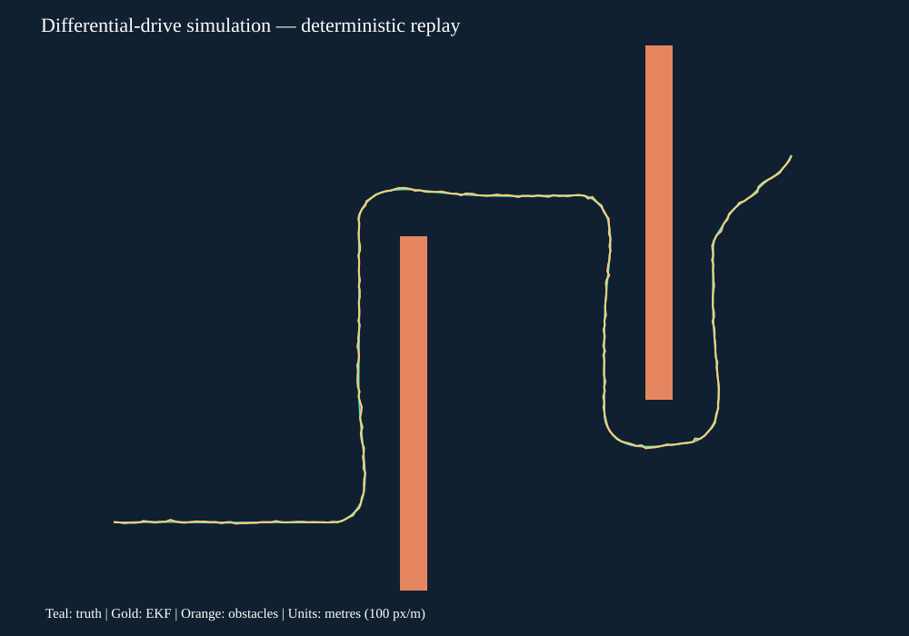
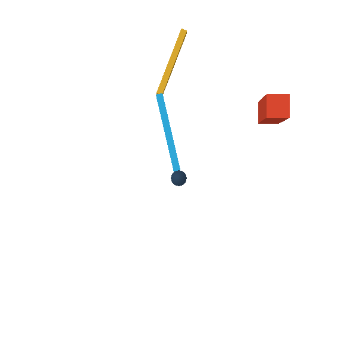

# Engineering & Robotics Portfolio — Nabwei

[](https://github.com/nabwei/engineering-portfolio/actions/workflows/validation.yml)

Projects in robotics, FPGA timing, measurement and computer vision, built with
C++, Python and VHDL. Each project includes source code, reproduction instructions
and documented test results.

**Über dieses Portfolio:** Hier dokumentiere ich meine Projekte zu Robotik,
eingebetteten Systemen und Messtechnik. Der Schwerpunkt liegt auf nachvollziehbaren
Implementierungen, Simulationen und Tests. Bildprüfung und visuell-inertiale
Odometrie sind noch in Entwicklung; ihre offenen Genauigkeitsprobleme sind dokumentiert.

## Start here

- [Validation results and known limits](docs/VALIDATION.md)
- [Development notes](docs/AI_DEVELOPMENT.md)
- [Reading guide](07_STUDY_GUIDES/README.md)

| Project | Code / reproduction | State |
|---|---|---|
| A · VHDL-2008 golden regression | [FPGA extension](https://github.com/nabwei/verilog-golden-regression/tree/main/01_FPGA_EMBEDDED) | Software criteria met; 48-bit counter, reset/enable, rollover, UART TX, mutation tests |
| B · AXI-Lite / Linux access | [Same canonical FPGA extension](https://github.com/nabwei/verilog-golden-regression/tree/main/01_FPGA_EMBEDDED) | Consistent counter reads and bus simulation; physical UIO unverified |
| C · FPGA–robot software co-simulation | [Same FPGA extension](https://github.com/nabwei/verilog-golden-regression/tree/main/01_FPGA_EMBEDDED) | HDL traces, timestamped sensors and deterministic C++ replay; not physical HIL |
| D · Industrial machine vision | [OpenCV inspection](03_COMPUTER_VISION/) | **Research prototype — accuracy gate FAIL** |
| E · Measurement uncertainty | [Measurement extension](https://github.com/nabwei/measurement-testbench/tree/main/05_MEASUREMENT_TIMING) | GUM-style propagation, Monte Carlo, sensitivity and notebook |
| F · PTP / timing analysis | [Same measurement extension](https://github.com/nabwei/measurement-testbench/tree/main/05_MEASUREMENT_TIMING) | Synthetic and Linux software measurements; independent clocks unverified |
| G · Differential-drive robot | [C++ robot core](02_ROBOTICS_NAVIGATION/robot_core/) | Kinematics, LiDAR, EKF, A*, Pure Pursuit and collision tests |
| H · ROS 2 navigation | [ROS 2 / Gazebo / Nav2](02_ROBOTICS_NAVIGATION/ros2_navigation/) | Three prospective simulated missions PASS using explicitly selected SLAM v2 |
| I · Visual-inertial odometry | [Stereo/IMU estimator](04_SENSOR_FUSION/) | **Research prototype — trajectory / initialization gates FAIL** |
| J · Robot arm | [PyBullet arm](02_ROBOTICS_NAVIGATION/arm/) | RRT*, collision checks, trajectory and basic MPC |
| K · Fleet telemetry | [MQTT / SQLite / HTTP](02_ROBOTICS_NAVIGATION/fleet/) | Local broker, collection, dashboard and fault tests |
| L · UAV inspection digital twin | [PX4 / Gazebo](06_UAV_DIGITAL_TWIN/px4_integration/), [reduced demo](06_UAV_DIGITAL_TWIN/inspection/) | Recorded simulated acquisition/reconstruction/coverage/replay; no real flight |

FPGA timing and measurement tools live in their existing repositories, linked above.
Robotics, vision, sensor fusion and UAV simulation are maintained here.

## Reproduce the software checks

Tested baseline: Ubuntu 24.04 / WSL2, Python 3.12, GCC 13. Inspect the bootstrap
before running it: it uses sudo/network to install development dependencies.

```sh
bash bootstrap_linux.sh
.venv/bin/python 00_MASTER_CONTROL/run_validation.py
```

The runner saves commands, exit codes and logs under a fresh `08_TEST_RESULTS/aggregate/`
directory and fails when a required check cannot run. It covers 14 build/test/static/demo
checks in this repository. It does **not** run full ROS/PX4 missions, acquire restricted
datasets, or turn unit-test success into an accuracy claim. Follow each module README
for optional integrations; ROS/PX4 are separate installations.

## Demonstrations





The replay and arm image are generated by the simulations. The [arm](02_ROBOTICS_NAVIGATION/arm/)
and [UAV demo](06_UAV_DIGITAL_TWIN/inspection/) also generate visual output; the fleet
module supplies a local live dashboard. These are simulated systems.

Code is [MIT licensed](LICENSE), with separate [third-party notices](THIRD_PARTY_NOTICES.md).
Datasets are downloaded separately under their own terms. Hardware and flight performance
have not been validated; see the project-specific limitations before reusing the code.
